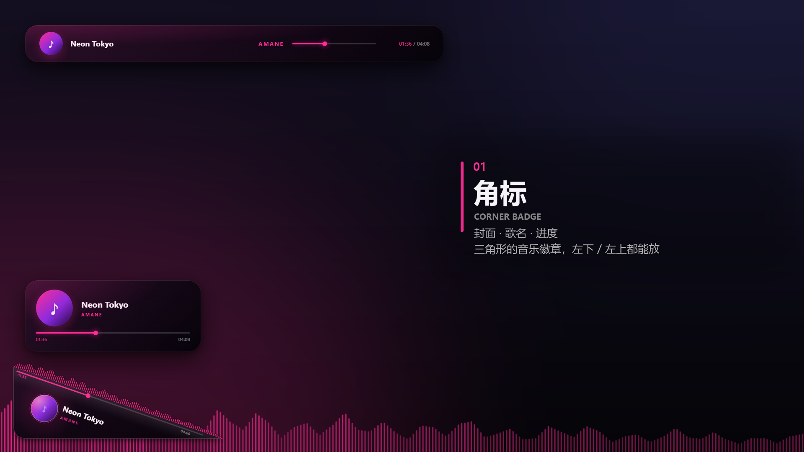
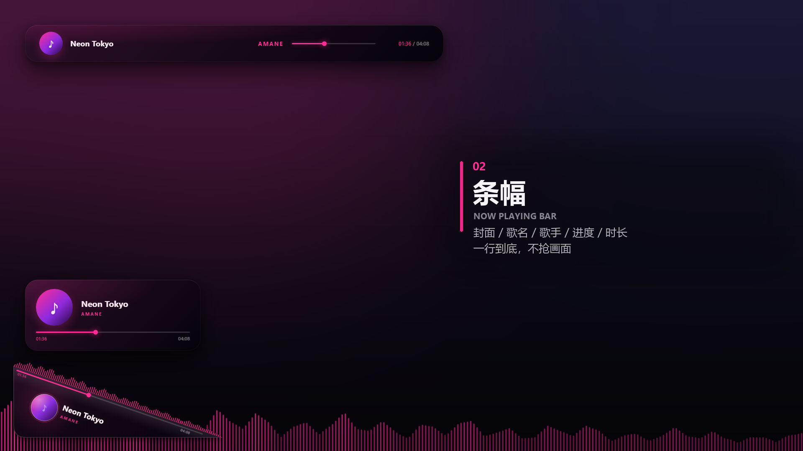
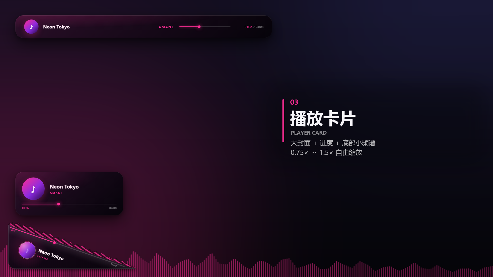
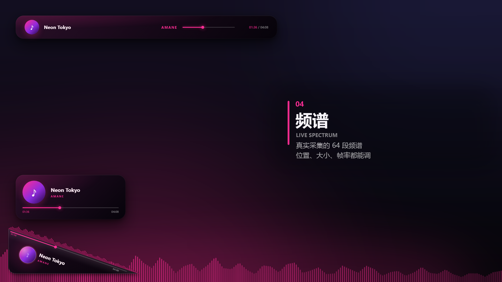

# Cosmolayor

**给 OBS 用的直播叠加层。** 一个浏览器源，四个组件，零第三方依赖，数据全本地。

`v1.0.0` · 作者 **11.2 / 天月焰** · 代码 MIT、文档与效果图 CC BY 4.0






## 它是什么

直播时把「正在放什么歌」铺到画面上：**角标 / 条幅 / 播放卡片 / 频谱**，四个组件同一个页面、同一个坐标系，
OBS 里只加**一个**浏览器源（1920×1080、透明）。

- **数据全是真的，且全在本机**：歌名 / 歌手 / 封面 / 进度来自 Windows 媒体会话和网易云自己的日志，频谱是 WASAPI 回环实录
- **零第三方 Python 包**：不用 `pip install`，标准库 + Windows 自带组件（PowerShell 5.1、.NET `csc.exe`、WASAPI）就够
- **不联网、不登录、不上传**：没有云端，没有账号
- **控制面板**里拖一拖就有：位置 / 透明度 / 大小、8 套配色（4 套撞色带渐变）、跟随封面取色、整体圆角、封面旋转

## 30 秒上手

1. 下载 [Releases](../../releases) 里的 **`Cosmolayor-1.0.0-win64.zip`**，解压到任意目录（**自带 Python，不用安装**）
2. 双击 **`Cosmolayor.exe`** —— 弹出黑窗口（日志在里面），2 秒后自动打开控制面板
3. OBS → 来源 → 加号 → **浏览器**：宽 `1920` 高 `1080`，地址填 `http://127.0.0.1:8765/index.html`，勾「源不可见时关闭」

关掉那个黑窗口 = 停服务。只想跑服务不弹浏览器：`Cosmolayor.exe --no-open`。
（exe 被系统拦了就双击 `Cosmolayor.cmd`，功能一样。从源码跑也可以：`python -u server.py`，只要 Python 3.9+。）

> 详细用法、全部开关、手改参数、踩坑记录都在 **[`projects/overlay/README.md`](projects/overlay/README.md)**。
> 更新日志：**[`CHANGELOG.md`](projects/overlay/CHANGELOG.md)**。

## 仓库结构

```
.
├── projects/
│   ├── overlay/            ★ Cosmolayor 本体（服务 / 页面 / 控制面板 / 工具 / 效果图）
│   │   ├── Cosmolayor.exe      发布包里的启动器（源码 tools/launcher.cs；编译产物不进仓库）
│   │   ├── Cosmolayor.cmd      同一个东西的 bat 版（exe 被拦时用）
│   │   ├── server.py           静态服务 + 数据桥 + 频谱推流（一个进程）
│   │   ├── index.html          叠加层本体（OBS 填这个）
│   │   ├── control.html        控制面板
│   │   ├── js/ css/            页面逻辑与样式（含自写 FFT）
│   │   └── previews/github/    发布用效果图
│   └── corner-badge/      早期的角标成品与生成器（叠加层的几何就是从这里来的）
├── LICENSE                代码：MIT（文末附中文参考译文）
└── LICENSE-docs           文档与效果图：CC BY 4.0
```

## 兼容性

| 项 | 说明 |
|---|---|
| 系统 | Windows 10 20348+ / Windows 11（进程回环要这个版本；更老的系统自动退回整机混音） |
| 播放器 | **网易云音乐**：元数据 / 封面 / 真实进度全支持；其它播放器能拿元数据和封面，进度看它给不给 SMTC |
| OBS | 任意版本，浏览器源（CEF）即可；OBS 32 位/64 位都行（页面在 OBS 自带 Chromium 里跑） |

## 许可

- **代码**：[`LICENSE`](LICENSE)（MIT，附中文参考译文）
- **文档与效果图**：[`LICENSE-docs`](LICENSE-docs)（CC BY 4.0，有官方中文法律文本的链接）
- 音乐封面、艺人肖像、第三方商标**不在授权范围内**，权利归各自所有者
- **exe 目前没有代码签名**：第一次运行 Windows 会拦一下，点「仍要运行」；
  不想看到提示就双击 `Cosmolayor.cmd`（同一个程序，命令行版）

---

*Cosmolayor v1.0.0 · 2026-10-27*
