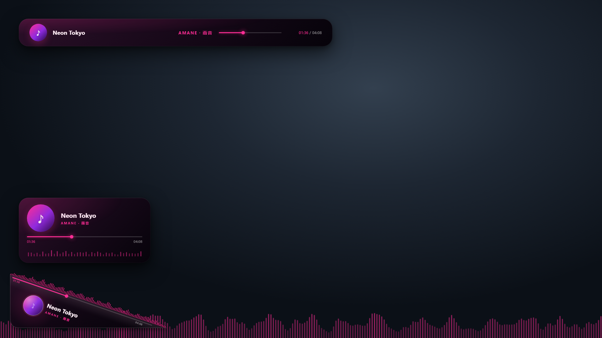
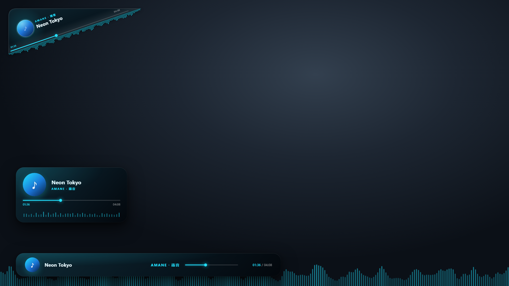
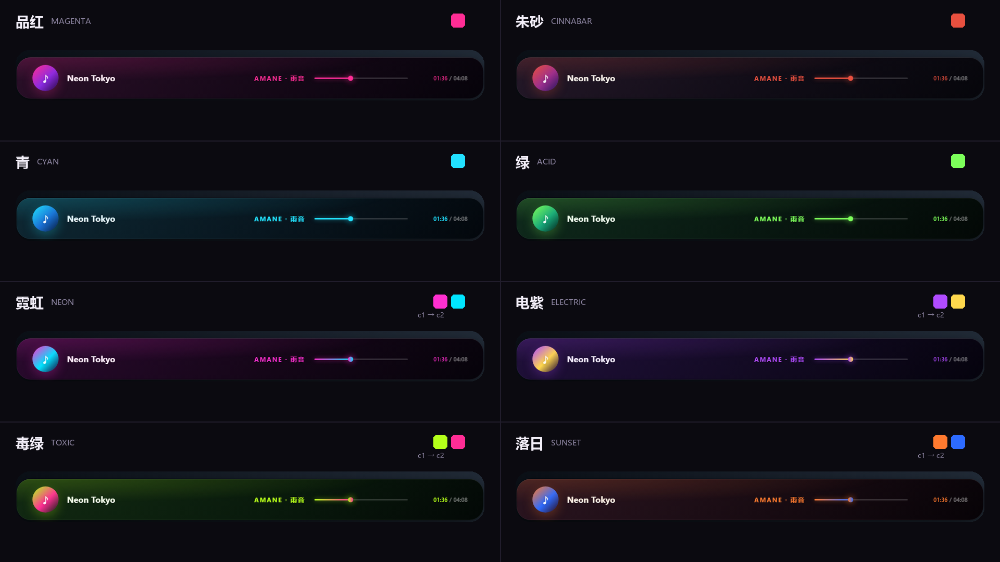

# Cosmolayor · 直播叠加层

v1.0.0 · 给 OBS 的直播叠加层：角标 + 条幅 + 播放卡片 + 频谱，一个页面、一个浏览器源、零第三方依赖。



---

## 快速开始

**双击 `Cosmolayor.exe`** —— 弹出一个黑窗口（服务日志都在里面），2 秒后**自动打开控制面板**。关掉这个窗口 = 停服务。

窗口里会写清楚三个地址，关之前不用记：

```
叠加层   http://127.0.0.1:8765/index.html     ← OBS 填这个
控制台   http://127.0.0.1:8765/control
数据桥   运行中 · SMTC
频谱     真实 · 进程回环 · cloudmusic.exe · 30fps
Ctrl+C 结束
```

> 只想起服务、不想它弹浏览器：`Cosmolayor.exe --no-open`。
> **第一次运行会被 SmartScreen 拦一下**（exe 还没做代码签名）：点「仍要运行」即可；不想看到提示就双击 `Cosmolayor.cmd`，功能一样。
> 服务已经在跑时再双击，它不会重复起，只会把控制面板打开。

其它启动方式：

```bash
start.cmd              # 等价，带黑窗口
python -u server.py    # 纯命令行
```

> 从 GitHub 仓库拿到的源码里**没有 `Cosmolayor.exe`**（编译产物不进版本库）：
> 直接 `python -u server.py`，或双击 `tools\build-exe.cmd` 用系统自带 `csc.exe` 重编一个。

**零依赖**：不用 `pip install` 任何东西，标准库 + 系统自带组件就够（详见文末「依赖与许可」）。

然后：

| 地址 | 用途 |
|---|---|
| `http://127.0.0.1:8765/control` | **控制面板**（开关、配色、实时预览） |
| `http://127.0.0.1:8765/index.html` | **叠加层本体**（OBS 填这个） |

OBS 里：来源 → 浏览器 → 宽 `1920` 高 `1080` → 地址填上面第二个 → 勾「源不可见时关闭」。

> 启动时加 `-u`（`python -u server.py`）能让日志立刻刷出来，不加也能用。


---

## 这一版做了什么

- 四个组件**同一坐标系**、同一份数据、一个 OBS 源（不再一个组件一个源）
- 控制面板改开关，叠加层 **500ms 内**跟上，不用重启、不用刷新源
- 待决策项**全部变成开关**，在面板里现场对比（见下）
- 数据桥内置在 `server.py` 里，只有一个进程要管
- **频谱是真的**：服务端用 ctypes 直调 WASAPI 回环录 PCM，页面里自写 FFT 算频段（抓不到时自动退回模拟）
- **零第三方 Python 包**：numpy / pyaudiowpatch / winrt / netease-cloudmusic-detector 四个依赖全部换成自写实现
- 条幅进度条回来了（3px 胶囊 + 11px 小球）；条幅一行到底：**封面 → 曲名 → 歌手 → 进度条 → 时长**（时长定宽，不再挤歌手）
- 角标可选左下 / 左上（几何镜像），进度条带实心小球；封面白边与 ♪ 40% 透明
- **播放卡片可等比缩放**：面板滑杆，或在预览里拖卡片右上角的圆点（0.75×～1.5×，锚点左下角）
- **大频谱可拖可缩**：无背景渐变，拖本体移动 / 拖右下角圆点缩放（0.4×～1.0×），面板「频谱」卡有读数 + 重置
- **卡片底部也有小频谱**（30px，和角标频谱同高上限），开关在组件「卡片」的 ▾ 次级菜单

### 几个决策 → 面板开关

| 原来的问题 | 现在 | 默认 |
|---|---|---|
| 条幅顶部还是底部 | 条幅位置：顶部 / 底部 | 顶部 |
| 封面圆还是圆角方 | 封面形状：圆形 / 圆角方 | 圆形 |
| 频谱通栏还是窄条 | 频谱形态：通栏 / 跟着条幅 | 通栏 |
| 角标斜边上的频谱要不要 | 角标频谱：显示 / 隐藏（收在组件「角标」的 ▾ 次级菜单里） | 显示 |
| 卡片底部要不要频谱 | 卡片频谱：显示 / 隐藏（收在组件「卡片」的 ▾ 次级菜单里，30px 高） | 显示 |
| 频谱数据多快 | 频谱帧率：30 / 60 fps（即时生效） | **30 fps** |
| 频谱放哪、多大 | 位置 / 缩放：在预览里拖频谱本体移动、拖右下角圆点缩放（0.4×～1.0×），面板显示 `x, y · 倍率` + 重置 | **0, 0 · 1.00×**（通栏底部） |
| 角标放哪 | 角标位置：左下 / 左上（几何会镜像） | **左下** |
| 卡片多大 | 卡片大小：滑杆 0.75×～1.5×，或拖预览里卡片右上角的圆点 | **1.00×** |

默认值是我按"直播里最实用"挑的，不喜欢在面板里点掉即可——不用改代码。



**八套配色**，开关在面板「配色」：前四套是常规（品红 / 朱砂 / 青 / 绿），
后四套是第十六轮加的**霓虹撞色**（霓虹 粉×青 / 电紫 紫×柠黄 / 毒绿 酸绿×品红 / 落日 橙×电蓝），
而且这四套的**强调色是渐变**（c1 → c2）：进度条、大频谱每一根条、角标斜线频谱、卡片小频谱都跟着走；
前四套保持纯色。文字色和封面外环仍是纯色（渐变字会糊）。

面板「配色 → 跟随封面」打开后，**每首歌按封面主色重新算一套配色**：把封面缩到 32×32 读像素、
丢掉灰/黑白、按色相分箱取主副色，再按可读性重新给饱和度和明度（墨底用主色压暗、环境光用副色）。
色相提取失败（灰封面 / 没有封面）就维持当前手动配色 —— 不会出现又灰又糊的配色。
下面还有「配色用渐变」：打开后自动配色也走 `主色 → 副色` 的渐变（和四套霓虹配色同一套机制），
频谱逐条插值，**开销可忽略**。



---

## 目录

```
overlay/
├── index.html          叠加层（OBS 用）
├── control.html        控制面板
├── visual-draft.html   最早的静态视觉稿（存档，不再维护）
├── css/
│   ├── overlay.css     叠加层样式（设计规范都在这里）
│   └── control.css     面板样式
├── js/
│   ├── palettes.js     八套配色（和 corner-badge 同源，后四套是霓虹撞色）
│   ├── badge.js        角标（几何和 build_badge.py 完全一致，只是吃实时数据）
│   ├── fft.js          自写 radix-2 FFT + 64 段映射（页面里算）
│   ├── spectrum.js     频谱渲染（canvas；真实/模拟共用）
│   ├── overlay.js      叠加层主逻辑
│   └── control.js      面板逻辑
├── server.py           本地服务 + 内置数据桥
├── bridge.py           数据桥（也可单独跑，调试用）
├── audio.py            自写 WASAPI 回环采集（ctypes 直调 COM）
├── cover.py            封面读取（调用下面那个 C# 小工具）
├── netease.py          自写 cloudmusic.elog 解码 + 播放状态机
├── REVIEW-TOP-LEFT.md  左上角标人工复核 / 更改表
├── requirements.txt    零依赖说明（不用 pip install）
├── tools/
│   ├── smtc-bridge.ps1 常驻 SMTC 读取（PowerShell 5.1 + WinRT）
│   ├── smtc-probe.ps1  一次性探测（排查用）
│   ├── cover-fetch.cs  读 SMTC 封面（首次抓封面时用系统 csc.exe 编译）
│   ├── selftest.py     产品自测（接口/数据/降级/安全，36 项）
│   ├── stress.py       稳定性自测（SSE 帧率/断档/CPU/内存）
│   └── shot.ps1        Edge 无头截图（做效果图用）
├── previews/           效果图 + badge-compare.html（左上角封面位置对比）
└── runtime/            运行时产物（state.json / now-playing.json / cover.jpg / bin/）
```

---

## 数据从哪来

`server.py` 内置 `bridge.py`，后台轮询 Windows SMTC：

```
实时读 SMTC（只认 cloudmusic / spotify / qqmusic / foobar / musicbee / aimp / potplayer / zune）
  → 过滤掉 Chrome，B 站视频不会串进来
  → 元数据走 PowerShell（WinRT 会话接口）
  → 封面走自写的 C# 小工具：读系统媒体浮窗里那张（一般 108×108），落盘 runtime/cover.jpg
  → 进度：有真进度就用（Spotify/浏览器）；网易云走它自己的日志 cloudmusic.elog（真实 position + 时长）
  → 写 runtime/now-playing.json
        ↓ 同一个进程发 HTTP
OBS 页面每 500ms 拉 /api/snapshot；频谱另开一条 SSE 收 PCM
```

> **为什么网易云的进度要读日志**：SMTC 的 timeline 四个字段（start/end/position/max_seek）
> 对网易云恒为 0，`last_updated_time` 甚至还是 `1601-01-01` —— 接口有能力，客户端没实现。
> 客户端会把播放事件写进 `%LOCALAPPDATA%\NetEase\CloudMusic\cloudmusic.elog`，
> `netease.py` 自己解码后能拿到真实 position、时长，连拖进度条都知道。
>
> **为什么封面要单独写 C#**：SMTC 的 Thumbnail 是跨进程 WinRT 流对象，
> PowerShell 5.1 投影不出来（拿到裸 `__ComObject`，`Size` 为空）。
> `tools/cover-fetch.cs` 不用 `AsTask`（本机没有 SDK 的 `Windows.winmd`），
> 而是轮询 `IAsyncOperation.Status` 再取 `GetResults()`，用系统自带的 csc.exe 现场编译即可。

**没歌的时候叠加层是空的**（OBS 里不显示假数据）。想看效果就开面板的「演示模式」，或者用预览地址加 `?demo=1`。

### 已知限制（实测过，别再试）

1. **网易云的进度靠读日志** —— SMTC 里 timeline 全是 0，得靠 `cloudmusic.elog`；`netease.py` 解析失败（客户端改格式）时会退回计时估算（会漂），诊断里能看到
2. **频谱得靠服务端抓** —— 浏览器抓不到系统音频，现在是 ctypes 调 WASAPI 录 PCM、页面算 FFT；服务没开、抓不到回环设备、或声卡是独占模式时，自动退回模拟动效
3. **进程回环要 Win10 20348+ / Win11** —— 老系统上 `ActivateAudioInterfaceAsync` 会报 `0x80070057`，此时把 `audioLock` 置空退回整机混音（或启动加 `--audio-all`）
4. **同一个 exe 开多份时会挑错** —— `find_root_pid` 优先选「树里有进程正在出声」的那条；都在出声就取第一条
5. **没有歌词** —— 第十一轮按用户要求整个删掉（面板 / LRC 匹配 / 状态字段），代码里不再有这条链路
6. **封面只有 108×108** —— 就是系统媒体浮窗里那张（角标 32 / 条幅 56 / 卡片 88 用刚好，再放大会虚）。要高清只能联网查，按"叠加层不抢画面"的原则不做
7. **只用 Windows** —— WASAPI / SMTC / WinRT 都是 Windows 组件；换系统要重写 `audio.py` 和 `tools/cover-fetch.cs`

### 真实频谱是怎么做的

**两种捕获方式**（面板「频谱 → 音频来源」切换，默认只抓网易云）：

```
【进程回环 · 默认】只录一个程序（默认 cloudmusic.exe，含它的子进程树）
  ActivateAudioInterfaceAsync(VAD\Process_Loopback) → IAudioClient
  浏览器、微信通知、别的播放器、系统提示音 全部进不来
  需要 Win10 20348+ / Win11；目标没开就推静音（不会退回假动效）

【整机混音 · 老行为】WASAPI 回环（audio.py 用 ctypes 直调 COM，录"正在播放的声音"）
  → 整个输出设备的声音都进来

  两种方式后面完全一样：
  → 单声道 int16，每 33ms 取最近 2048 点（48k 下约 43ms 窗；切 60fps 时 16.7ms 一帧）
  → SSE（/api/pcm-stream，base64）30fps 推给页面（面板可切 60）
  → 页面 js/fft.js：Hann 窗 → radix-2 FFT → 对数频率取 64 段
  → 低频重，加 4.5dB/oct 倾斜；再按整体 RMS 做相对映射（音量大小不影响画面高度）
  → 上升快、回落慢；静音门（没声音就落下去）
  → canvas 按 60fps 插值绘制（数据 30/60fps 都跟得上）
```

实测：服务端 **0.5% CPU**（12 核平均，30fps，含数据桥 + 回环采集）、31MB 内存；
页面里 2048 点 FFT 单帧 **约 0.3ms**（Node 实测），30fps 约 1% 单核（60fps 翻倍）。
帧率在面板「频谱帧率」里切 30/60（即时生效），或启动加 `--fps 60`。
想省 CPU 可以 `python server.py --no-audio`，频谱就回到模拟动效。

### 卡住了先看「诊断」

控制面板最下面的「诊断」卡片会摊开数据桥的内部状态：

| 行 | 正常应该是 | 不正常时 |
|---|---|---|
| 数据桥 | 运行中（绿） | 「子进程已退出」→ 点「重启数据桥」 |
| 轮询间隔 | `800 ms` | 空 → 桥没起 |
| 媒体会话 | `cloudmusic.exe · Playing` | 「无媒体会话」→ 播放器没开或没在放 |
| 进度来源 | `真实 · 网易云日志` / `真实 · SMTC` | 「估算（兜底）」→ 暂时拿不到真进度 |
| 音频采集 | `锁定 · cloudmusic.exe (pid …)` | 「模拟」→ 抓不到回环设备 / 采集被独占；进程回环还没连上时会显示等待 |
| 封面缓存 | `24 KB` | 「无」→ 这首歌 SMTC 没给封面 |

也可以直接看 JSON：`http://127.0.0.1:8765/api/diag`（含 SMTC 原始一行）。

---

## 调试与出图

| 参数 | 作用 |
|---|---|
| `?debug=1` | 右下角显示桥状态 / 频谱模式 / 滚动偏移 / 当前布局组合；JS 报错也会显示出来 |
| `?bg=studio` | 加假背景（预览、截图用；OBS 别加） |
| `?instant=1` | 关掉过渡动画，截图不截到半透明帧 |
| `?demo=1` | 没歌时用演示数据（控制面板预览固定带这个） |
| `?nosse=1` | 不开真实频谱长连接（无头截图必须加，否则等不到"网络空闲"会挂住） |
| `?pcm=1` | 配合 `nosse=1`：改成单次拉 PCM，截图时也能看到真实频谱 |
| `?show=all` 或 `?show=banner,card` | 临时覆盖组件可见性，不动已保存的开关 |
| `?levels=0.2,0.8,...` | 调试：直接喂 64 个频段值，验证真实频谱那条渲染路径 |
| `?title=xxx&artist=yyy` | 调试：临时换歌名，看长标题滚动效果 |
| `?pos=95&dur=248` | 调试：钉住进度和总时长（出宣传图时六张图的时间码才一致，OBS 里别加） |
| `?palette=cyan&bannerPos=bottom&badgePos=tl&cardScale=1.3&specScale=0.8&...` | 临时覆盖任意布局状态，用来出对比图（`badgePos`：bl / tl；`cardScale` 0.75～1.5；`specScale` 0.4～1.0；`specX` / `specY`） |
| `?edit=1` | 编辑模式：卡片右上角出现缩放手柄（控制面板的预览自动带这个；**OBS 别加**） |

截图（本机执行策略禁 .ps1，必须带 Bypass）：

```powershell
powershell.exe -NoProfile -ExecutionPolicy Bypass -File .\tools\shot.ps1 `
  -Url "http://127.0.0.1:8765/index.html?bg=studio&instant=1&demo=1" `
  -Out "previews\default.png"
```

单独看数据桥在干什么：

```bash
python bridge.py        # 每秒打印歌名 / 进度 / 来源
```

### 宣传图（GitHub 发布页用）

`previews/github/` 里有 8 张 1920×1080：

| 文件 | 内容 |
|---|---|
| `01-corner-badge.png` | 角标 |
| `02-now-playing-bar.png` | 条幅 |
| `03-player-card.png` | 播放卡片 |
| `04-spectrum.png` | 频谱 |
| `05-solid-color.png` | **纯色**强调色（朱砂） |
| `06-gradient-color.png` | **渐变**强调色（霓虹） |
| `07-cover-color.png` | 跟随封面取色（纯色） |
| `08-cover-gradient.png` | 同一套取色 + 渐变 |
| `_demo-cover.png` | 07/08 用的演示封面（自己画的抽象图，不用真实专辑图） |

前四张是**默认布局**下的整屏，各自用一团光把对应的元素点亮；05/06 是纯色 vs 渐变的对照；
07/08 用同一张封面演示"从封面抓主色"，一张纯色一张渐变（标题旁直接给出**抓到的色值**和封面缩略图）。
生成脚本在 `.tmp/promo.py`（不进仓库：它依赖 Pillow 和无头 Edge，只是出图工具）：
透明背景截图 → 按强调色打底 → 叠标题块。图里的歌名是内置演示数据（`Neon Tokyo / AMANE`），
封面用上面那张自制的抽象图，不涉及任何第三方素材。

### 产品自测

```bash
python tools/selftest.py          # 36 项：接口/数据/开关/安全/降级（约 30 秒，结束恢复 state.json）
python tools/selftest.py --tone   # 加一项 -26dB 测试音，验证 WASAPI 回环真录到声音（会响 2 秒）
python tools/stress.py            # 30 秒 × 2 客户端：帧率、seq 断档、CPU、内存
```

最近一次结果见 [`TEST-REPORT.md`](TEST-REPORT.md)（30 通过 / 1 跳过 / 0 失败）。

---

## 手改参数（不改代码）

改布局不用碰 JS：**能在面板里点的都存进 `runtime/state.json`**，也可以直接手改这个文件。

> ⚠️ **手改 `state.json` 前先关掉服务**（`start.cmd` 的窗口）。服务在跑的时候状态在内存里，
> 下一个开关动作会把内存里的旧值整个写回文件，你的手改就被盖掉了。改完再起服务即可。

### 一、布局 / 显示（`runtime/state.json`）

| 想改什么 | 键 | 可选值 / 范围 |
|---|---|---|
| 哪个组件出现 | `visible.badge` `visible.banner` `visible.card` `visible.spectrum` | `true` / `false` |
| 配色 | `palette` | `magenta` / `cinnabar` / `cyan` / `acid` / `neon` / `electric` / `toxic` / `sunset` |
| 条幅在顶还是底 | `bannerPos` | `top` / `bottom` |
| 封面圆形还是圆角方 | `coverShape` | `circle` / `square` |
| 频谱形态 | `spectrumMode` | `full`（通栏）/ `narrow`（条幅窄条） |
| 频谱数据帧率 | `spectrumFps` | `30` / `60` |
| 角标在哪个角 | `badgePos` | `bl`（左下）/ `tl`（左上）——**右半边已否掉，别试** |
| 卡片大小 | `cardScale` | `0.75` ～ `1.5`（锚点左下角） |
| 卡片底部小频谱 | `cardSpectrum` | `true` / `false`（关掉卡片高 208 → 170） |
| 大频谱形态 / 帧率 | `spectrumMode` / `spectrumFps` | 见上表 |
| 大频谱位置 / 大小 | `specX` / `specY` / `specScale` | 见下面「二」 |
| 角标头上那条频谱 | `badgeSpectrum` | `true` / `false` |
| 没歌时是否整个隐藏 | `hideWhenIdle` | `true` / `false` |
| 演示数据 | `demo` | `auto` / `on` / `off` |
| 音频来源 | `audioLock` | `cloudmusic.exe`（只抓网易云）/ `""` 空串（整机混音） |
| 整体圆角 | `radius` | `0`～`44`（`0` = 直角；墨块 / 角标三角 / 圆角方封面都跟着变） |
| 封面旋转 | `coverSpin` | `true` / `false`（播放时转、暂停时停；**只在圆形封面下有效**，圆角方不支持） |
| 跟随封面取色 | `autoPalette` | `true` / `false`（每首按封面主色重算；取不到色就保持手动配色） |
| 自动配色也用渐变 | `autoGrad` | `true` / `false`（主色 → 副色；只在「跟随封面」开着时显示。开销和霓虹配色一样，可忽略） |

范围外的值服务端会自动夹到边界（比如 `specScale: 9` → `1.5`），非法值直接忽略、保留旧值。

**只是想看看效果** 不用改文件：面板预览最省事，或者在地址栏临时覆盖，例如
`?palette=cyan&badgePos=tl&cardScale=1.3&specScale=0.8&specX=900&specY=200`（完整参数表见上一节）。

### 二、每个组件的透明度 / 大小 / 位置（第十三轮）

四个组件都能在控制面板里拖到任意位置；三个墨块还能拖滑杆调透明度和大小。

| 组件 | 透明度 | 大小 | 位置 |
|---|---|---|---|
| 角标 | `badgeOpacity` `0`～`1` | `badgeScale` `0.4`～`1.0` | `badgeX` / `badgeY` |
| 条幅 | `bannerOpacity` `0`～`1` | `bannerScale` `0.4`～`1.0` | `bannerX` / `bannerY` |
| 播放卡片 | `cardOpacity` `0`～`1` | `cardScale` `0.75`～`1.5` | `cardX` / `cardY` |
| 大频谱 | —（没做，需求只要三个） | `specScale` `0.4`～`1.0` | `specX` / `specY` |

两条要记住的规则：

- **坐标**：`X` = 左边距（`-200`～`1200`），`Y` = **距底边**（`0`～`1080`，不是距顶）。
  四个组件同一套，改的时候不用换算。
- **缩放上限就是当前默认大小**（`1.0×`，只能缩不能放）；卡片是例外，仍然 `0.75`～`1.5`。
  锚点统一在**左下角**，所以缩小时左下角不动 —— 代价是：条幅放在顶部时缩小会往**下**收，
  离开顶边一段距离，需要的话把它往上拖回去。

面板里每个组件都有「重置」：位置回默认（会按角标在哪边自动避让）、大小回 `1×`、透明度回 `100%`。
这些都在**组件卡里各自的 ▾ 菜单**中（第十四轮起：角标 ▾ 里还有"角标位置/左下左上"、条幅 ▾ 里有"条幅位置/顶部底部"；
「外观」卡只剩封面形状 / 封面旋转 / 整体圆角）。

### 三、长文字怎么处理（不截断，滚动 + 淡出）

- **条幅**：曲名和作者超长时都**来回滚动**（以前作者是省略号），两端 12px 淡出
- **卡片**：曲名滚动（作者仍是省略号，和以前一样）
- **角标**：曲名/作者在**几何算出来的安全盒**里滚动，两端淡出。
  盒子有多宽是按"这一行走到末尾时**字形**（不是基线）离形状边缘还剩多少"算出来的
  （`badge.js` 的 `TEXT_MARGIN = 14` + `fontMetrics()` 量的 ascent/descent），
  所以**不会再顶到三角形的底边/顶边**：左下角标歌名 148px、作者 99px；左上角标歌名 143px、作者 96px。
  字距也算进宽度了（作者 2.2px/字，长歌手名以前会被低估几十 px）。

### 四、要改代码的少数常量

这几个不在面板里，因为改一次就基本不再动：

| 想改什么 | 位置 | 现在的值 |
|---|---|---|
| 长标题滚动速度 | `js/overlay.js:298` | `dist / 32` → 约 32 px/s，**改大更快**（角标文字也用这个速度） |
| 拖右下角缩放频谱的灵敏度 | `js/overlay.js:843` | `/ 700`（700 舞台像素 ≈ 1 倍），嫌慢改小如 `/400` |
| 卡片高度 | `css/overlay.css:215`、`:222` | `208px`；关卡片频谱时 `170px`（两个要一起改） |
| 角标频谱条最高多高 | `js/badge.js:112` | `* 30` px |
| **角标文字离形状边缘留多少** | `js/badge.js` 的 `TEXT_MARGIN` | `14`（px，按**字形**算：越大文字越短、越不容易贴边） |
| 滚动文字两端的淡出宽度 | `css/overlay.css:165` | `12px`（角标那两行在 `badge.js` 的 mask 里：尾巴淡出 `FADE = 22px`） |
| 频谱高频补偿 | `js/fft.js:12` | `TILT_PER_OCT = 4.5`（dB/oct），觉得高频太少就调大 |
| 条幅各段宽度 | `css/overlay.css:129`、`:143`、`:150` | 歌手 ≤ `260px`、时长 ≥ **`108px`**、进度条 `200px` |
| 时间码字号 | `css/overlay.css`（`.time` / `.card .time`）、`js/badge.js:286` | 条幅 **11.5px**、卡片 **10.5px**、角标 SVG **8.4px** |
| 各组件的缩放 / 透明度范围 | `js/overlay.js:95-97` + `server.py:74-80` | 两边各一份常量，**改要一起改**（自测里有夹取断言盯着） |
| 角标造型 / 封面位置 | `js/badge.js`（`CR` / `R` / `TL_COVER` / `TL_TEXT` / `mkGeom`） | ⚠️ 改造型**先改 `projects/corner-badge/build_badge.py`，再同步过来**，别只在 `badge.js` 手改 |

改完 JS/CSS 记得：**OBS 的浏览器源要双击源 → 确定刷新一次**（它是常驻 Chromium，不然还在跑旧代码）；
改了 `server.py` 则必须重启服务。

---

## 设计规范（别重新发明）

| 项目 | 值 |
|---|---|
| 画布 | 1920×1080，透明 |
| 圆角 | 默认 30px，面板「外观 → 整体圆角」可调 **0～44**（角标三角也跟着变） |
| 进度条 | 胶囊 3px，圆头 |
| 主色 | 品红 `#FF2D95`（八套见 `js/palettes.js`） |
| 文字 | 暖白 `#FFF0F7`，弱化 42% 白 |
| 墨底 | `#2A0F28 → #150817 → #06030A`（135°） |
| 字体 | Segoe UI / 微软雅黑 |

角标的几何（三角形、斜边频谱、斜边内侧时间轴）和 `projects/corner-badge/build_badge.py` **完全一致**，只是把这个成品接到了实时数据上。要改角标造型，改生成器再同步过来，别在 `badge.js` 里手改。

四个角试过：右半边（右下 / 右上）也做了镜像版本，但左→右的阅读习惯改不掉 —— 标题必须从右往左排、
时间码和进度球也跟着翻，怎么调都别扭。**2026-10-27 决定删掉右半边，只留左下 / 左上**，别再来一遍。

当前两角就是同一套几何：左上为垂直镜像（封面 `(64,75)`、文字 `(64,77)`），左下是生成器定稿 `(74,118)`。

---

## 依赖与许可

**不需要 `pip install` 任何第三方包。** `requirements.txt` 现在只是说明文件。

| 能力 | 实现 | 依赖的系统组件 |
|---|---|---|
| 频谱采集 | `audio.py`，ctypes 直调 COM | Windows WASAPI（MMDevAPI.dll） |
| 频谱计算 | `js/fft.js`，自写 radix-2 | 无 |
| 封面 | `tools/cover-fetch.cs` | .NET Framework 4.x（`csc.exe`）+ `WinMetadata\*.winmd` |
| 网易云进度 | `netease.py`，自写 elog 解码 | 无 |
| 播放器元数据 | `tools/smtc-bridge.ps1` | Windows PowerShell 5.1（WinRT 投影） |

编译 `cover-fetch.cs` 产物在 `runtime/bin/`（运行时生成，不进版本库）。删掉它下次会自动重编。

---

## 许可证

- 版权人：**11.2**
- 代码：**MIT**（[`LICENSE`](../../LICENSE)，文末附中文参考译文；有出入以英文原文为准）
- 文档与效果图：**CC BY 4.0**（[`LICENSE-docs`](../../LICENSE-docs)，里面有官方中文法律文本的链接）
- 音乐封面 / 艺人肖像 / 第三方商标不在授权范围，权利归各自所有者
